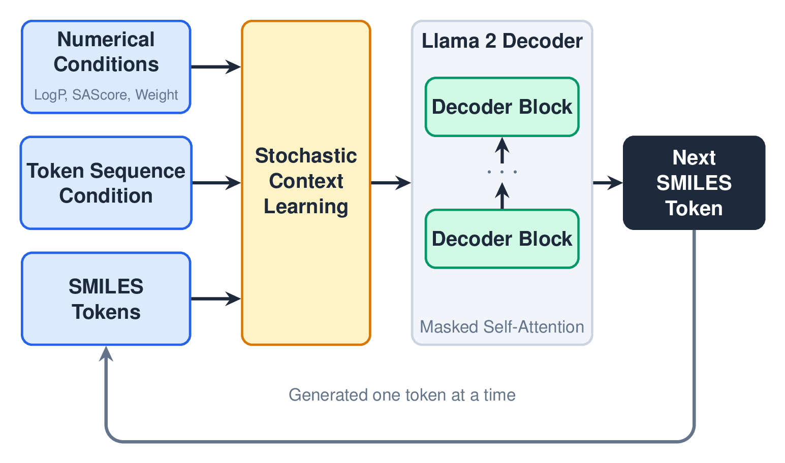

I'm Niklas Dobberstein, a PhD student in applied machine learning for chemistry in the Glorius group at the University of Münster.

<table>
  <tr>
    <td width="50%" align="center">
      
    </td>
    <td width="50%" align="center">
      
    </td>
  </tr>
  <tr>
    <td valign="top">
      <a href="https://github.com/GloriusGroup/tacit"><b>TACIT</b></a> 
      Reaction outcome prediction from positive-only data.
    </td>
    <td valign="top">
      <a href="https://github.com/nkls-ai/dftstream"><b>DFTStream</b></a> 
      Web UI and experiment tracker for ORCA quantum chemistry.
    </td>
  </tr>
  <tr>
    <td width="50%" align="center">
      
    </td>
    <td width="50%" align="center">
      
    </td>
  </tr>
  <tr>
    <td valign="top">
      <a href="https://github.com/nkls-ai/milo"><b>Milo</b></a> 
      Open-source desktop AI agent with local voice.
    </td>
    <td valign="top">
      <a href="https://github.com/Fraunhofer-SCAI/llamol"><b>Llamol</b></a> 
      Multi-conditional generative transformer for molecules.
    </td>
  </tr>
</table>

Also: [Materium](https://doi.org/10.1016/j.commatsci.2026.114980), an autoregressive transformer for crystal structures.
